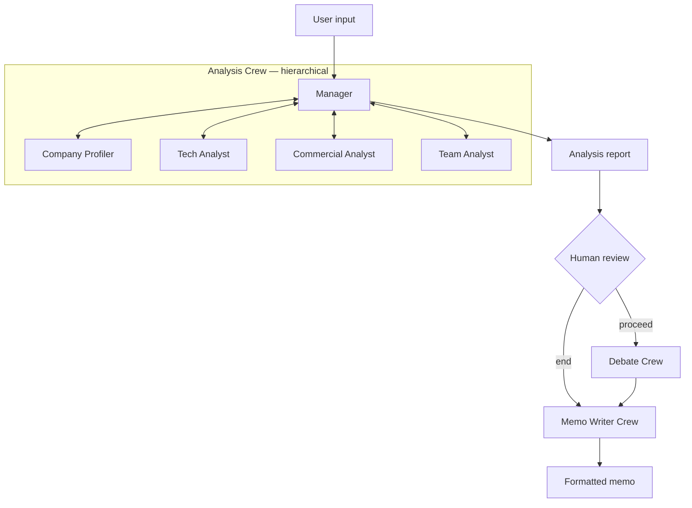
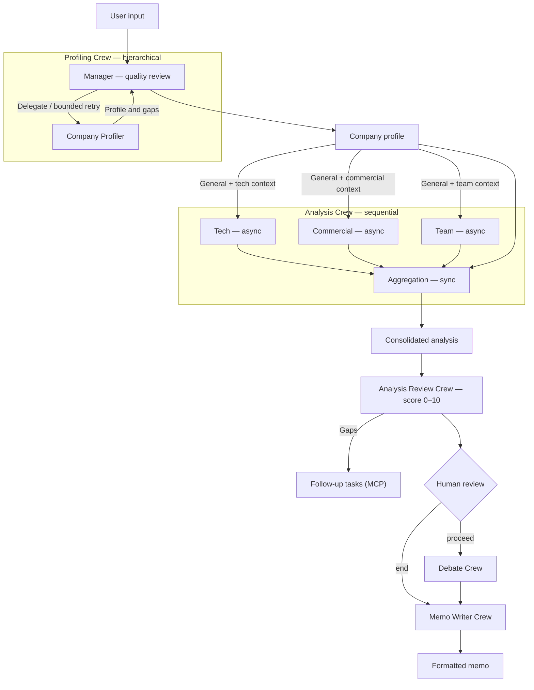
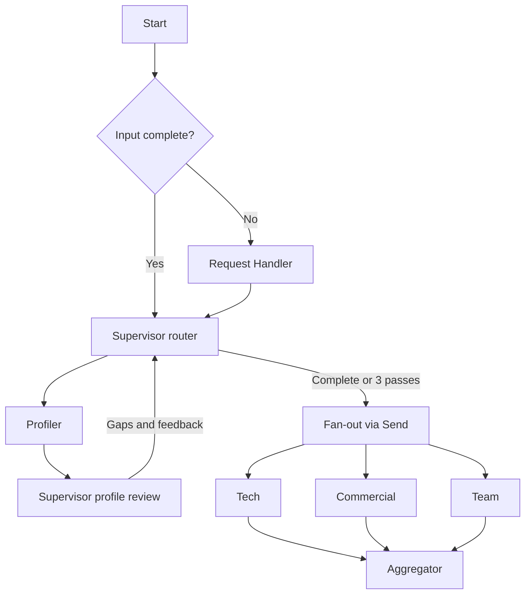
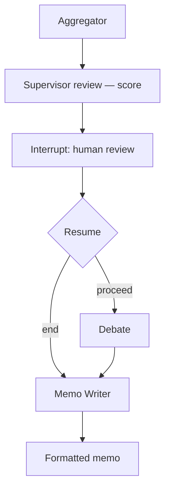

# Startup Due Diligence MAS — Architecture

Status: working draft · Updated: 2026-11-23

Related documents: [Open Points](open_points.md) · [Benchmark](benchmark_registry.md) · [State, persistence and observability](runtime.md) · [REST API](rest_api.md) · [MCP Server](mcp_task_server.md)

## Shared Agent Architecture

Each agent is a class that inherits from `BaseAgent`. Its description and task instructions live in shared constants, so CrewAI and LangGraph use the same text. A framework adapter maps them to the runtime inputs.

| Shared definition | CrewAI adapter | LangGraph adapter |
| --- | --- | --- |
| Agent description | Agent description and backstory | System prompt |
| Task instructions | CrewAI task | Human message |

## Orchestration Patterns and Agentic Paradigms

| Category | Implemented |
| --- | --- |
| Orchestration patterns | **Debate / adversarial** (Debate module: Pro vs. Contra, judged); **Supervisor** (manager or Supervisor node); **Sequential** (crew and node chaining) |
| Agentic paradigms | **ReAct** (basic, for agents using tools); **Reflexion** (the Supervisor in LangGraph reviews profile and analysis and feeds back to improve them) |

## Common Pipeline

Both frameworks follow the same logical steps:

1. **Profiling** — build the company profile and record missing information.
2. **Analysis** — Tech, Commercial and Team specialists, then one aggregation.
3. **Analysis review** — a reviewer gives the aggregated analysis a completeness score (0–10), lists missing items and may create follow-up tasks through the task manager MCP tools.
4. **Human review** — the user sees the analysis and the score, then chooses `proceed` or `end`.
5. **Debate** (only on `proceed`) — Formatter, Pro Extractor, Contra Extractor, Judge, in sequence.
6. **Memo Writer** — one agent, one task: the final formatted memo.

The score informs the human; it does not decide the route. An automatic gate on the score is not implemented (see [OP-04](open_points.md#op-04--score-based-debate-gating)).

## CrewAI — Version 1

Status: **discarded**. Both blocking problems were confirmed ([OP-01](open_points.md#op-01--overlapping-delegation-during-asynchronous-execution), [OP-02](open_points.md#op-02--non-deterministic-context-handoff)). Only Version 2 goes forward to testing.

A CrewAI Flow coordinates three crews. Profiling is part of the hierarchical Analysis Crew.

| Order | Stage | Configuration | Output |
| --- | --- | --- | --- |
| 1 | Analysis Crew | Hierarchical: manager, Company Profiler, Tech, Team and Commercial agents | Intermediate analysis report |
| 2 | Debate Crew | Sequential | Debate findings and judgment |
| 3 | Memo Writer Crew | One agent, one task | Final memo |

The manager delegates to the specialists, so the specialists cannot safely run in parallel and the context they receive is chosen by the manager.

## CrewAI — Version 2

Version 2 removes the manager from the analysis. Profiling becomes a separate crew and the specialists run as explicit asynchronous tasks.

| Order | Crew | Process | Output |
| --- | --- | --- | --- |
| 1 | Profiling | Hierarchical: manager and Company Profiler | Company profile and information gaps |
| 2 | Analysis | Sequential: three async specialist tasks, then one synchronous aggregation task | Consolidated analysis |
| 3 | Analysis Review | One agent (the Supervisor as reviewer), one task | Score (0–10), missing items, summary, optional follow-up tasks |
| 4 | Debate | Sequential | Debate findings and judgment |
| 5 | Memo Writer | One agent, one task | Final memo |

### Profiling Crew

The manager guarantees the profile quality. The Profiler gathers information with search and retrieval tools. If information is missing, the manager can ask for another iteration. A fixed maximum iteration count bounds the loop, and prompt instructions discourage repeating the same request. Remaining gaps are recorded as missing information.

### Analysis Crew

Tech, Commercial and Team run in parallel. Each receives the general profile plus only its own specialist context, which reduces noise and unnecessary agent loops. A Memo Writer agent then waits for all three and aggregates them with the profile into one analysis. This aggregation is separate from the final memo.

### Analysis Review Crew

A single reviewer scores the whole aggregated analysis from 0 (nothing usable) to 10 (every area covered and source-backed). It checks topic coverage, grounding in the profile, cited sources and explicit gaps. It returns a score, a list of missing items and a short summary.

If gaps need human work, the reviewer creates follow-up tasks through the task manager MCP tools (see [MCP Server](mcp_task_server.md)): at most one per topic (tech, commercial), assigned by role, with priority HIGH, MEDIUM or LOW. Team gaps are only mentioned in the review.

### Debate Crew

The four agents run in this order: Formatter, Pro Extractor, Contra Extractor, Judge.

### Memo Writer Crew

One agent, one task. It consolidates the profile and specialist analyses, plus the Debate output when Debate has run, into the final memo.

### Human Review

After the Analysis Review the Flow shows the analysis preview and the score and asks whether to proceed.

| User decision | Route | Result |
| --- | --- | --- |
| `end` | Memo Writer directly | Memo from profile and analyses, no Debate cost |
| `proceed` | Debate, then Memo Writer | Memo including debate findings |

Skipping Debate saves its tokens and time; the memo is still generated.

### Version Comparison

| Aspect | Version 1 | Version 2 |
| --- | --- | --- |
| Status | Discarded | Under test |
| Crews | Three | Five (Profiling, Analysis, Analysis Review, Debate, Memo Writer) |
| Manager role | Coordinates analysis and delegation | Guarantees profiling quality only |
| Specialist execution | Hierarchical with async tasks; overlapping delegations | Explicit async tasks, then synchronous aggregation |
| Context transfer | Chosen by the manager | General profile plus selected specialist context |
| Analysis review | None | Reviewer with score |

## LangGraph

A single graph orchestrates the workflow and reuses the shared agent classes. The Supervisor is a project-defined node with a code-based router; it does not use `create_supervisor` or LLM-driven routing.

| Node | Responsibility |
| --- | --- |
| Request Handler | Asks the user for company information. Skipped when the input is already complete (for example a full REST request). |
| Supervisor and router | Calls the Profiler, reviews the profile and returns gaps and feedback. Proceeds to Fan-out when the profile is complete or after three passes in total. |
| Profiler | Produces the profile, using the Supervisor feedback on later passes. |
| Fan-out | Uses `Send` to run Tech, Commercial and Team in parallel. |
| Aggregator | Waits for the three analyses and consolidates them with the profile. Control returns to the Supervisor. |
| Supervisor review and interrupt | Scores the consolidated analysis (completeness score and review summary), then interrupts for human review. |
| Memo Writer | Formats the final memo. Both resume paths end here. |

### Resume after Human Review

| Resume value | Route |
| --- | --- |
| `end` | Memo Writer directly |
| `proceed` | Debate, then Memo Writer |

The user's value selects the route; the score only informs the decision. The SQLite checkpointer resumes the graph with the same `thread_id`, even after a restart. See [LangGraph Persistence and Resume](runtime.md#langgraph-persistence-and-resume).

### Flow Diagram — Profiling and Analysis

### Flow Diagram — Review and Memo

