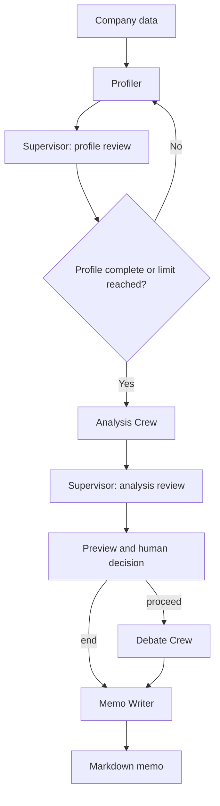

# Startup Due Diligence MAS — Framework Choice and Target Architecture

Related documents: [Architecture](architecture.md) · [State, persistence and observability](runtime.md) · [REST API](rest_api.md) · [Benchmark](benchmark_registry.md) · [Open Points](open_points.md)

> **Why LangGraph, and where CrewAI still fits**
>
> CrewAI Flows support routing, persistence, and pause and resume after human feedback. We still prefer LangGraph for this project because the graph makes the shared state, the transitions and the resume points explicit. Analysis and Debate stay CrewAI crews, each invoked by a graph node. The Supervisor is a single agent that evaluates gaps and completeness. The graph enforces the profiling retry limit, and the user decides whether to run the Debate.
>
> The boundary of Analysis sets the granularity of recovery. If the three specialists live inside one CrewAI node, LangGraph sees the whole crew as one unit of execution. Recovering the work of a single analyst requires configuring and verifying the crew's internal checkpoint, or exposing the analysts as LangGraph nodes. This is an architectural choice. Memo quality, reliability, cost and latency still need to be compared with an equivalent configuration.
>
> [LangGraph Checkpointers](https://docs.langchain.com/oss/python/langgraph/checkpointers) · [CrewAI Human Feedback](https://docs.crewai.com/en/learn/human-feedback-in-flows) · [CrewAI Crews](https://docs.crewai.com/en/concepts/crews)

**Decision.** Use LangGraph to orchestrate the end-to-end workflow and CrewAI inside the Analysis and Debate nodes. The POC keeps both implementations as a basis for comparison. The target architecture (section 6) describes the proposed solution.

## 1. Context and Requirements

The system builds a startup profile, collects the Tech, Team and Commercial contributions in parallel and consolidates them into a preview. The user reviews the preview and decides whether to include a Debate before the final memo is written.

The framework choice is mostly about the dependencies between phases:

- Each specialist must receive the general profile and the context of its own area.
- Evidence from different phases must be comparable and preserved even when it diverges.
- The review must suspend the analysis and resume it with the user's decision and the context already collected.

## 2. CrewAI with Flows

### Strengths

- **Multi-agent work definition.** Agent, Task and Crew group responsibilities, context, expected output and guardrails. This fits Analysis (three specialists and a consolidation step) and Debate (distinct roles in a stable sequence). [CrewAI Crews](https://docs.crewai.com/en/concepts/crews) · [CrewAI Tasks](https://docs.crewai.com/en/concepts/tasks)
- **Bounded delegation.** The hierarchical process lets a manager assign work and check the result. In V2 the manager can ask the Profiler to fill gaps within a configured limit. [CrewAI Hierarchical Process](https://docs.crewai.com/en/learn/hierarchical-process)
- **Application orchestration.** Flows support typed Pydantic state, events, conditional routing, persistence and human feedback. This is enough to express the functional path of the POC. [CrewAI Flows](https://docs.crewai.com/en/concepts/flows) · [CrewAI Human Feedback](https://docs.crewai.com/en/learn/human-feedback-in-flows)

### Weaknesses in the POC

- **Manager delegation adds variability when analysts and inputs are already defined.** In V1, the hierarchical process combined with asynchronous tasks produced overlapping delegations, and some delegations summarized the context too aggressively (see [OP-01 and OP-02](open_points.md)). These are observations about the V1 configuration, not general framework limits.
- **The Flow still has to define data handoffs between crews.** As dependencies grow, application code must decide which evidence to pass, how to validate outputs and how to reconcile diverging findings. In V2 the specialists receive explicit inputs, start in parallel and converge on an aggregator. The effect of this change is still to be measured.
- **End-to-end REST resume is still to be verified.** The human feedback demo stores the pause in SQLite and keeps the HTTP state in memory. Full server-side execution persistence is still open in the CrewAI POC.

## 3. LangGraph

### Strengths

- **Explicit state and transitions.** Nodes read the state and return updates. The graph gathers in one inspectable place the links between phases, the conditions to advance and the merge rules for fields updated in parallel. [LangGraph Graph API](https://docs.langchain.com/oss/python/langgraph/graph-api)
- **Supervisor judgment separated from routing.** The Supervisor identifies gaps and evaluates completeness. Application rules decide when to repeat profiling and how to route the resume after the review.
- **Resume tied to the execution.** The interrupt exposes the preview and the checkpointer saves the state under `thread_id`. The server can reuse the graph compiled at bootstrap and resume the thread with the user's decision. The POC uses SQLite. [LangGraph Interrupts](https://docs.langchain.com/oss/python/langgraph/interrupts) · [LangGraph Persistence](https://docs.langchain.com/oss/python/langgraph/persistence)

### Weaknesses in the POC

- **More implementation work.** The state schema, routing, aggregation conditions and reducer semantics must be designed and verified. Composing a whole multi-agent phase in the graph also means invoking each agent and wiring the outputs.
- **Persistence requires application consistency.** A resume restarts from the beginning of the suspended node, so operations run before the interrupt must be safe to repeat or live in an earlier node. Recovery after a restart also depends on the database being available and on checkpoints staying consistent with the REST records. [LangGraph Interrupts](https://docs.langchain.com/oss/python/langgraph/interrupts)

## 4. Why LangGraph for the Main Orchestration

| Need | Choice | Reason |
| --- | --- | --- |
| Manage context across profiling, analysis, review and memo | LangGraph | The state makes explicit what is read, updated and kept at each step. |
| Run Tech, Team and Commercial on targeted inputs | Analysis Crew | The three specialists run in parallel inside the phase, with a structured contract towards the graph. |
| Enforce profiling limits and resume after the review | LangGraph routing | Code applies the iteration limit and selects the branch after the human decision. |
| Extract pros and cons and give a judgment | Debate Crew | A bounded sequence with defined inputs and outputs. |
| Evaluate the profile and the completeness of the analysis | Supervisor as a single agent | The node receives the needed context directly and returns a structured evaluation. |

The criterion is **how much control is needed over data and transitions between phases**. In the Inkeep memo, for example, Profiling and Team report a seed round while Commercial states that it found no evidence. The target architecture must keep both pieces of evidence, distinguish missing evidence from a contradiction, and show the conflict in the preview. The same rule can be implemented in a CrewAI Flow. LangGraph gives an explicit point to define how that data enters the state and reaches the review and the memo. The rule that interprets the evidence remains a project responsibility.

Tracing is available in both ecosystems. The lifecycle also differs: CrewAI creates a Flow instance per analysis, while the backend reuses one compiled graph. The impact on latency is still to be measured. [CrewAI Tracing](https://docs.crewai.com/en/observability/tracing) · [LangGraph with LangSmith](https://docs.langchain.com/langsmith/trace-with-langgraph)

## 5. POC Evidence and Open Checks

The CrewAI runs on Boom and Inkeep give qualitative evidence on the memos. The available registry has no equivalent LangGraph runs with complete configurations, so the preference for LangGraph concerns the orchestration design. Memo quality, reliability, tokens, cost and latency still need a comparison.

| Check | Evidence to collect |
| --- | --- |
| Memo quality | Source coverage, section quality and handling of diverging evidence, with equivalent input, model and tools. |
| Analysis stability | Completion of the three specialists, context completeness, concurrency errors and correctness of the aggregation. |
| Review and resume | Preview consistency, isolation between threads and resume after a restart, on both branches. |
| Cost and latency | Tokens, cost and duration per phase, with initialization and human wait recorded separately. Also measure the Supervisor's contribution to profile coverage. |

The end-to-end benchmark compares the complete implementations. To attribute a result to the framework, the test must be repeated with the same orchestration logic. Automatic selection of the Debate remains an open point ([OP-04](open_points.md#op-04--score-based-debate-gating)).

## 6. Target Architecture

**LangGraph is the orchestrator. Analysis and Debate are two nodes that each invoke a CrewAI crew. The Supervisor is a single agent invoked by the graph, with the context it needs provided by the node.**

| Component | Contract and responsibility |
| --- | --- |
| **Profiler and Supervisor** | The Profiler builds the profile. After each pass the same Supervisor agent returns gaps and search hints. The graph repeats profiling until the profile is complete or three passes in total (the first included) have run, per the POC rule. After Analysis, the Supervisor evaluates completeness and returns a score and a summary for the review. |
| **Analysis Crew** | The node passes the general profile and the area context to the Tech, Team and Commercial specialists. The crew runs the tasks in parallel and consolidates the results. The node returns structured contributions and evidence, missing information and the consolidated analysis to the graph. |
| **Human review** | LangGraph suspends the thread and exposes the preview through Get Status. Resume uses the same `thread_id` and receives `proceed` or `end`. The human decision sets the path. The Supervisor score is informational. |
| **Debate Crew** | On `proceed`, the graph passes the consolidated analysis to the crew. The sequence is Formatter (if enabled), Pro Extractor, Contra Extractor and Judge. The node returns the Debate results to the graph. |
| **Memo Writer** | On `end`, the graph goes straight to the memo. Both branches converge on the same step, which produces the Markdown returned by Get Memo and includes the Debate results when present. |

**Graph and crew boundary.** The graph keeps the data shared between phases and the state needed to resume. The crews manage their own tasks and return results through the node that invokes them. In the LangGraph POC the three analysts are nodes started with `Send`, and concurrent writes to the profile use `merge_profile`. In the target architecture the analysts' parallelism is internal to the Analysis Crew, and the graph receives one consolidated result when the crew ends. Reducers still apply to fields updated concurrently at graph level.

**Possible evolution.** Consider replacing the nodes that use `create_agent` for single invocations with structured model calls in steps that do not need the agent-tool loop. Keep an agent in steps that require search or iterative tool use. Decide node by node.
