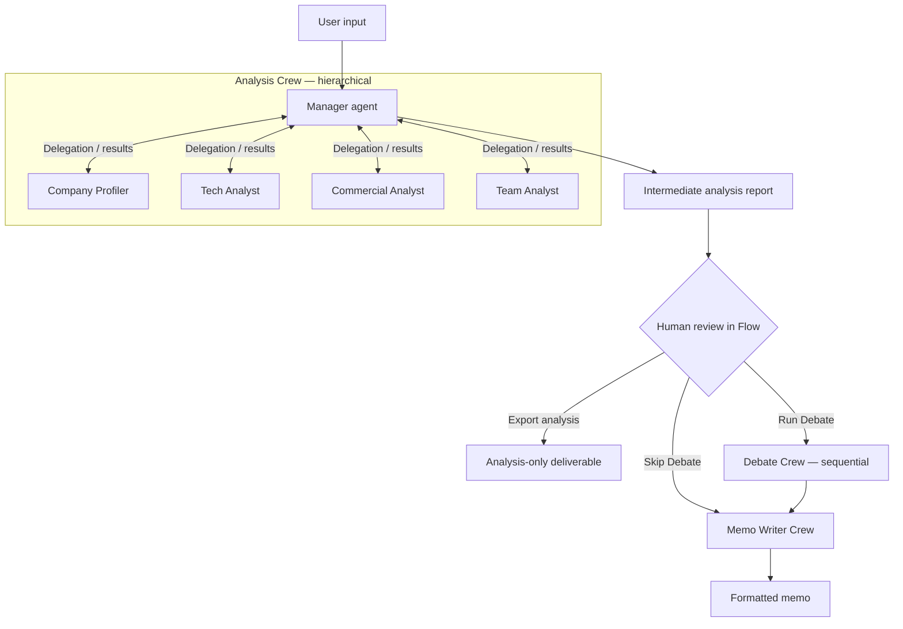
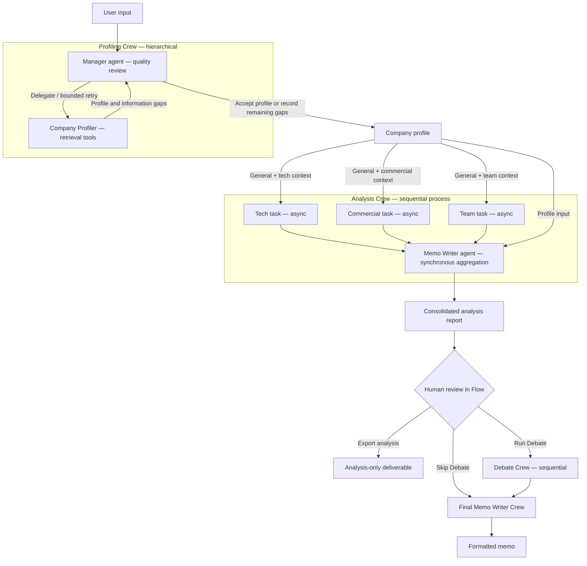

# Startup Due Diligence MAS — Architecture

Status: working draft · Updated: 2026-11-15

Related documents: [Overview](due_diligence_overview.md) · [Open Points](due_diligence_open_points.md)

## CrewAI — Version 1

A CrewAI Flow coordinates three crews and collects the startup name, website, sector and additional information from the user.

| Order | Stage | Configuration | Output |
| --- | --- | --- | --- |
| 1 | User input | Managed by the Flow | Startup information |
| 2 | Analysis Crew | Hierarchical; manager agent with an LLM, Company Profiler, and Tech, Team and Commercial agents | Intermediate analysis report |
| 3 | Debate Crew | Sequential: Formatter, Pro Extractor, Contra Extractor, Judge | Debate findings and judgment |
| 4 | Memo Writer Crew | One agent, one task | Structured, formatted final memo |

### Flow Diagram — Version 1

The Flow owns orchestration and the human decision. Arrows inside the Analysis Crew represent manager-mediated delegation and returned results, not guaranteed parallel scheduling.

Asynchronous execution within the hierarchical crew produced the overlapping delegation and context-transfer issues recorded in OP-01 and OP-02. Debate runs Formatter, Pro Extractor, Contra Extractor and Judge in order.

### Analysis Crew

The manager coordinates task execution and delegation among the specialist agents, then structures the intermediate analysis report.

Parallelism is required. Testing of hierarchical orchestration combined with asynchronous tasks exposed overlapping delegation attempts; see [OP-01](due_diligence_open_points.md#op-01--overlapping-delegation-during-asynchronous-execution).

A separate issue concerns the context supplied by the manager during delegation; see [OP-02](due_diligence_open_points.md#op-02--non-deterministic-context-handoff).

### Debate Crew — Shared by Both Versions

The four agents execute sequentially in this order:

1. Formatter.
2. Pro Extractor.
3. Contra Extractor.
4. Judge.

This crew does not change between the two CrewAI versions.

### Memo Writer Crew — Shared by Both Versions

A single agent executes a single task, consolidating the initial company profile and individual specialist analyses, plus Debate output and Judge findings when Debate has run.

It produces the final synthesis and formatted due diligence memo. This crew does not change between versions.

### Profiling and Human Review

Profiling is part of the initial Analysis Crew in Version 1 and is extracted into a separate crew in Version 2.

Human-in-the-loop review is implemented through the CrewAI Flow after Analysis and before Debate. It applies only to the CrewAI implementation described here.

The Flow displays a preview of the analysts' report and asks whether to proceed. The Debate Crew is initialized only when the user chooses to run it.

| User decision | Route | Result |
| --- | --- | --- |
| Analysis is sufficient as-is, or evidence is insufficient for a meaningful debate | Export Analysis output; do not run Debate or final Memo Writer | Analysis-only deliverable |
| A formatted memo is wanted without Debate | Skip Debate; invoke Memo Writer directly | Memo based on profiling and specialist analyses |
| Debate is useful and supported by sufficient information | Run Debate, then Memo Writer | Memo including debate findings |

The purpose is to let the user inspect the analysis before spending more tokens and time. Skipping Debate avoids its execution cost; directly exporting Analysis also avoids final memo-generation cost. The direct Memo Writer route still incurs memo-generation cost.

The stage tables show the full path; downstream execution is conditional on this decision.

### Proposed Automation — Not Yet Implemented

Introduce an information-sufficiency check at the entry to the Debate stage, before running the full Debate Crew. It would score the analysts' output for whether enough evidence exists to support a useful debate.

An illustrative rule is: score above 6/10 permits Debate; otherwise return the analysis-only output. The scoring criteria, threshold and equality case are not finalized. Sufficient evidence permits Debate but does not prove Debate is necessary. How this score interacts with the human decision remains to be defined; see [OP-04](due_diligence_open_points.md#op-04--automated-debate-eligibility-check).

## CrewAI — Version 2

An alternative version was introduced following problems combining hierarchical orchestration with parallel execution.

The Flow coordinates four crews. Only the initial analysis stage changes; the Debate and Memo Writer crews remain the same.

| Order | Crew | Process | Output |
| --- | --- | --- | --- |
| 1 | Profiling | Hierarchical: manager agent and Company Profiler | Company profile, including missing information |
| 2 | Analysis | Sequential process; three asynchronous specialist tasks followed by a synchronous aggregation task | Consolidated detailed analysis |
| 3 | Debate | Sequential: Formatter, Pro Extractor, Contra Extractor, Judge | Debate findings and judgment |
| 4 | Memo Writer | One agent, one task | Formatted final memo |

### Flow Diagram — Version 2

The Flow runs Profiling before Analysis. Specialist tasks receive the general profile plus their relevant specialist information; the synchronous aggregator waits for all three results.

Profiling retries are bounded by the configured maximum iterations and guided by prompt instructions against repeated requests for the same missing information. The Analysis Crew's aggregation task and the final Memo Writer Crew are separate execution stages. Debate retains the same four-agent sequence as Version 1.

The proposed automated score is intentionally excluded from both current-architecture diagrams because it is not implemented.

### Profiling Crew

The manager acts as the quality guarantor for the profile. The Profiler uses search and other retrieval tools to gather company information. When information is missing, the manager may delegate another retrieval iteration within configured limits.

The implementation combines a hardcoded maximum iteration count with prompt instructions not to repeatedly request the same unavailable information. Remaining gaps are recorded as missing information. The prompt instruction guides behavior; the configured iteration limit bounds execution.

### Analysis Crew

Tech, Commercial and Team tasks use asynchronous execution and run in parallel. Each receives the general company profile plus the portion relevant to its specialty. Unrelated specialist information is excluded to reduce irrelevant context, distraction and unnecessary agentic loops.

A Memo Writer agent then performs a synchronous aggregation task. It waits for all three specialist tasks and combines their analyses with the company profile into a detailed intermediate analysis.

This aggregation task is distinct from final memo generation, which occurs in the separate Memo Writer Crew after Debate or directly after human review when Debate is skipped.

### Version Comparison

| Aspect | Version 1 | Version 2 |
| --- | --- | --- |
| Crew count | Three | Four |
| Profiling | Inside the hierarchical Analysis Crew | Separate hierarchical crew |
| Supervisor role | Coordinates analysis and delegation | Guarantees profiling quality |
| Specialist execution | Hierarchical orchestration combined with asynchronous tasks; overlapping delegations observed | Explicit asynchronous tasks in a sequential process, followed by synchronous aggregation |
| Context transfer | Manager selects and reformulates delegated context | General profile plus explicitly selected specialist context |
| Debate and final memo | Shared downstream design | Same as Version 1 |

Version 2 changes orchestration to address the observed issues; improvement must still be evaluated through testing. The necessity of a supervisor remains an [open question](due_diligence_open_points.md#op-03--is-supervisor-orchestration-necessary).

## LangGraph

Status: TBD. Architecture and implementation details are to be defined; implementation remains to do. No LangGraph diagram is specified at this stage.
